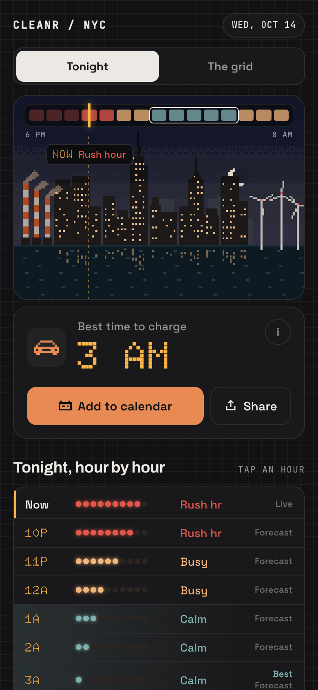
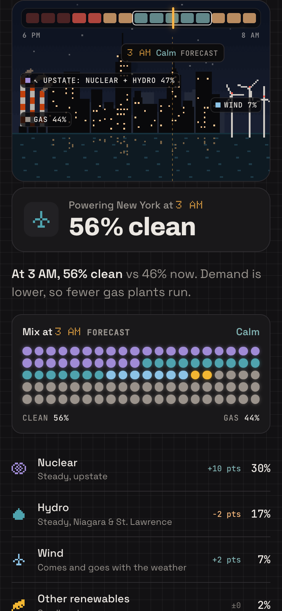
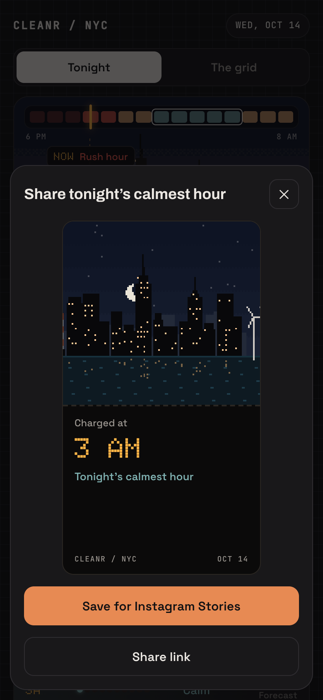

# Cleanr NYC

**The best time to charge your EV tonight, in New York.**

🔗 **Live:** https://janhavipatel25-builds.github.io/cleanr-nyc/

Cleanr NYC is a mobile-first web app for New York EV drivers who charge at home or in a garage overnight.
It finds tonight's **calmest hour on the grid** (when the fewest gas plants are running) inside
Con Edison's off-peak window (12–8 AM), and leads with one answer: *"Best time to charge: 3 AM."*

Think of it as **a weather app for the grid**: what's powering New York right now, plus a forecast through the night.

<p>
  
  
  
</p>

## Why
Electricity in New York isn't equally clean at every hour. Nuclear and hydro run steadily, wind comes and goes,
and **gas plants ramp up and down to follow demand**. Late at night demand drops, fewer gas plants run, and each kWh
carries less CO₂. Charging a few hours later is an easy win, and it lines up with off-peak pricing.

## What you can do
- **Tonight:** see the best hour, the calm stretch around it, and every hour from now to 8 AM.
  Add it to your calendar, or share a Stories-sized card.
- **The grid:** drag through the night and watch the mix change: a 100-dot fuel mix, each source's share,
  and "now vs the calmest hour".
- **The skyline is the data:** lit windows = demand, smokestack smoke = gas share,
  turbine speed = wind share, haze = how busy the hour is compared with the rest of tonight.

## How it works
```
                      every hour (GitHub Actions)
NYISO CSVs ──► fetch ──► hourly mix ──► intensity ──► forecast ──► tonight model ──► tonight.json
                                                                       │  checked against
                                                                       ▼  docs/tonight.schema.json
                                                     React app (GitHub Pages)
                                         adds clock-based parts: Now · Live · best hour · calm stretch
```
- **No server, no database.** A Python pipeline runs every hour, writes one checked file, and the static app reads it.
- **One shared model drives both views.** Tonight and The grid are two lenses on the same hours.
- **Clear ownership.** The pipeline owns the *data* (mix, intensity, forecast, labels).
  The app owns anything that depends on the *clock* (Live, best hour, calm stretch, "data delayed").
  So a late hourly update can never show a best hour that's already over.
- **A contract between the two.** `docs/tonight.schema.json` defines the file. The pipeline refuses to publish
  a file that breaks it, and the last good file stays live.
- **Always New York time,** even if you open it in London.

## Data and method
| | |
|---|---|
| **Fuel mix** | [NYISO](https://www.nyiso.com/) real-time fuel mix (5-minute, statewide), averaged to hours |
| **Demand forecast** | NYISO hourly load forecast (statewide) |
| **Emission factors** | EPA eGRID2023 (rev 2), New York output rates: gas 932.164 lb/MWh (≈ 423 g/kWh), oil 1121.16 lb/MWh (≈ 509 g/kWh) |
| **Intensity** | g CO₂/kWh = Σ(MW × factor) ÷ Σ MW of in-state generation. Nuclear, hydro, wind, other renewables = 0 |
| **Groups** | Nuclear · Hydro · Wind · Other renewables · Gas (natural gas + dual-fuel + other fossil) |
| **Zero-carbon assumption** | Other renewables (incl. biomass and landfill gas) count as 0, a common convention for biogenic CO₂ |
| **Labels** | Calm / Busy / Rush hour = the calmest, middle and busiest **thirds of tonight's hours** |
| **Best hour** | Lowest-intensity hour inside Con Ed off-peak (12–8 AM) that isn't over yet. Late at night, if the calmest hour has passed, the app says "calmest off-peak hour **left** tonight" |

### The forecast, and how good it is
NYISO forecasts **demand**, not carbon. Gas follows demand, so the app predicts gas from NYISO's demand forecast
(a straight line fitted on the last 14 days). Nuclear and wind hold their latest value; hydro and other
renewables use the same hour's 7-day average.

Tested by replaying 21 real nights (Sept 24 – Oct 14, 2026), forecasting each one at 5 PM:

| Method | Avg error (g CO₂/kWh) | Picked hour was among the 3 calmest | Labels matching |
|---|---|---|---|
| **Gas from demand forecast (shipped)** | **9.5** | 15/21 | 59% |
| Gas from demand minus clean power | 13.4 | 13/21 | 55% |
| Typical pattern (same hour, last 7 days) | 18.8 | 16/21 | 63% |
| Typical pattern adjusted by demand | 10.2 | 14/21 | 60% |

For scale, a night's calmest and busiest hours are about 30 g/kWh apart. That's why every future hour says **Forecast**.
Reproduce it: `backend/.venv/bin/python backend/scripts/backtest.py --nights 21`.

## Honest by design
- Says **"calmest hour"**, never "cleanest". No "you saved X grams" claims.
- Every hour is labelled **Actual**, **Live** or **Forecast**.
- **Statewide** data, and the app says so. Imports from other states aren't in NYISO's feed.
- No promised finish times (we don't know your battery) and no dollar savings (rate plans vary).
- Calm / Busy / Rush are **relative to tonight**, and the app says that too.

## Design
- Ported faithfully from an approved prototype (`cleanr-prototype.html`, mock data, never shipped).
- Single dark "night" theme. Pixel art is the only illustration language.
- Fonts: Archivo (display), Space Grotesk (UI), **Doto only for times**, JetBrains Mono (labels).
- State colours only on state elements, always with a text label. Respects reduced motion. Works from 320px wide.

## Tech
**Backend:** Python 3.13 · pandas · jsonschema · pytest
**Frontend:** React 19 · Vite · Tailwind CSS 4 · Vitest
**Ops:** GitHub Actions (CI + hourly build) · GitHub Pages

## Run it locally
```bash
# backend: build tonight's file from live NYISO data
cd backend
python3 -m venv .venv && .venv/bin/pip install -r requirements.txt
.venv/bin/python -m cleanr --out ../frontend/public/tonight.json --cache .cache

# frontend
cd ../frontend
npm install
npm run dev            # http://localhost:5173/cleanr-nyc/
```

## Tests
- `backend/`: `.venv/bin/pytest`: 73 tests (data parsing, daylight saving, intensity, forecast, labels, contract).
- `frontend/`: `npm test`: 55 tests, run on London time on purpose to prove New York-time handling.
- `frontend/`: `node scripts/ui-check.mjs`: 42 click-through checks in a real browser
  (keyboard, downloads, reduced motion, the 16-hour daylight-saving night, 6:30 AM copy, old data, 320–440px).

## Project structure
```
backend/    Python pipeline (cleanr/), tests, backtest script, sample tonight.json
frontend/   React app (src/components, src/lib), tests, screenshot + UI-check scripts
docs/       product brief, design spec, data notes, decision log, build plan, JSON contract
.github/    CI and hourly deploy workflows
```
More: [product brief](docs/product-brief.md) · [design spec](docs/design-spec.md) ·
[data notes](docs/data-notes.md) · [decision log](docs/decisions.md) · [build plan](docs/plan.md)

## Limitations
- Statewide data only; NYC's local mix isn't published.
- In-state generation only; imports aren't included.
- The forecast holds wind at its latest value (NYISO's feed has no wind forecast).
- GitHub's hourly schedule can run a few minutes late. The app shows "Data delayed" (with the date) if the data is over 3 hours old.
- **GitHub pauses scheduled jobs after 60 days with no repo activity.** If the site says "Data delayed" with an old date,
  re-enable the "Deploy" workflow in the Actions tab (or push any commit).

## Coming next
Tonight on the wall (anonymous posts) · Solar as its own source · laundry, dishwasher and device timing.

---

This line was added by Claude Code (the Claude agent), not by the user.
